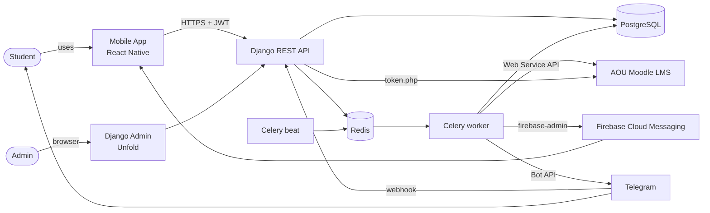
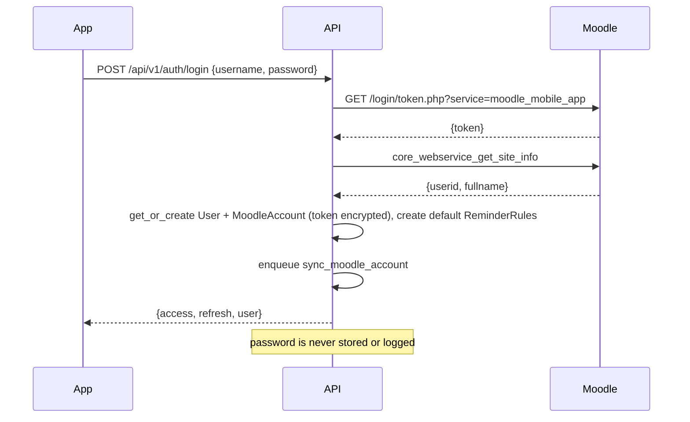
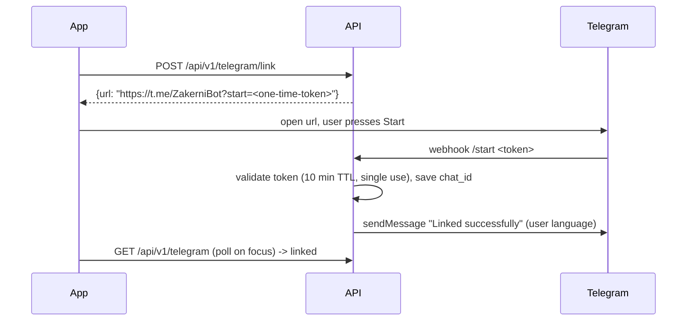

# 01 — System Design

## 1. Context



## 2. Components

| Component | Responsibility |
|---|---|
| **Mobile app** | UI, calendar, forms, reminder settings, registers FCM token, opens deep links from notifications |
| **Django API** | Auth (Moodle login -> JWT), CRUD, reminder rules, reports, Telegram webhook |
| **Django Admin** | Reports, broadcasts, statistics, sync/delivery logs |
| **Celery beat** | Triggers periodic jobs |
| **Celery worker** | Moodle sync, reminder scheduling, reminder dispatch, broadcasts |
| **PostgreSQL** | All persistent data |
| **Redis** | Celery broker + result backend, short-lived caches |
| **Moodle** | Source of quizzes, TMAs, courses (students can also add quizzes manually) |
| **FCM** | Push delivery to Android/iOS |
| **Telegram Bot API** | Telegram delivery, account linking |
| **SIS** (optional) | Exam schedule and lecture timetable (section 9) |

## 3. Periodic jobs

| Job | Schedule | What it does |
|---|---|---|
| `enqueue_moodle_syncs` | every 30 min | Enqueues `sync_moodle_account(account_id)` for each active account (spread with countdown jitter) |
| `enqueue_sis_syncs` | every 6 hours | Enqueues `sync_sis_account(account_id)` for each `active`/`error` SIS account (countdown jitter; section 9) |
| `expand_lecture_schedules` | daily 00:10 Cairo | Fills any missing future lecture `Item`s (create/edit already generates every occurrence up to `ends_on`) |
| `dispatch_due_reminders` | every minute | Sends `ScheduledReminder` rows with `send_at <= now` and `status = pending` |
| `cleanup` | daily 03:00 / 03:05 Cairo | `reminders.cleanup` deletes finished reminders (> 90 days); `notifications.cleanup_link_tokens` deletes expired Telegram link tokens |

## 4. Core flows

### 4.1 Login



**App accounts and optional university connection (phone-side fetch).** Moodle answers 403 to the server's cloud IPs, so the student's phone talks to Moodle (and later the SIS) itself and the backend never calls Moodle. The Moodle token and the SIS password stay on the phone (secure storage); the backend stores only what the phone posts. The identity is the app's own account: the student registers with the student number and an app password, and connects the university afterwards, optionally, from Settings.

```mermaid
sequenceDiagram
    participant App
    participant Moodle
    participant API
    App->>API: POST /api/v1/auth/register {username, password, language?}
    API->>API: create User (hashed password), default ReminderRules
    API-->>App: 201 {access, refresh, user, is_new: true}
    Note over App: later, Settings -> Connect university
    App->>Moodle: token.php + get_site_info (own device and network)
    Moodle-->>App: {token}, {userid, fullname, ...}
    App->>API: POST /api/v1/me/lms/connect {username, moodle_user_id, full_name, email, site_url}
    API->>API: MoodleAccount without token; fill empty name/email
    API-->>App: {connected: true, status, ...}
    App->>Moodle: courses, groups, quizzes, assignments, calendar events
    App->>API: POST /api/v1/me/lms/ingest {courses, groups, group_members, quizzes, assignments, calendar_events}
    API->>API: PayloadMoodleClient -> the unchanged SyncMoodleAccount
    API-->>App: {status, items_created, items_updated, items_removed, last_synced_at}
```

- **Identity.** `POST /auth/register` creates the account (`moodle_username` holds the normalised student number: 3 to 32 ASCII letters/digits, lowercase; the password goes through Django's password validators and is stored hashed). `POST /auth/signin` authenticates. Every sign-in failure (wrong password, unknown user, legacy account with an unusable password, inactive user) returns the same `401 invalid_credentials`, and 10 failures per username in 15 minutes lock the username out (`429 too_many_attempts`, cache counter, cleared on success). Both endpoints also share the login throttle (5/min per IP). `POST /auth/change-password` blacklists the user's refresh tokens and returns a fresh pair. Legacy accounts created by the server-side LMS login have an unusable password: registering their username answers `409 username_taken`, and staff can give them a password.
- **Recovery.** There is no forgot-password flow yet. Staff use the Unfold user admin: the standard password change form, or the action "Set a temporary password" (generates a password, shows it once in an admin message, blacklists the user's refresh tokens and clears the lockout).
- **Connect / disconnect.** `POST /me/lms/connect` creates or updates the `MoodleAccount` (no token) and fills `full_name`/`email` only when empty. `GET /me/lms` answers 200 `connected: false` when there is none. `DELETE /me/lms` deletes the `MoodleAccount`, soft-deletes the user's Moodle-sourced items (their pending reminders are cancelled through the scheduler) and deactivates the user's enrollments; manual items, lecture schedules and SIS data are kept. Decision: disconnecting must stop Moodle reminders, but data the student typed or imported from the SIS is theirs.
- **No server fetch.** `MoodleAccount.token_encrypted` is empty for phone-connected accounts. `enqueue_moodle_syncs`, `sync_moodle_account_task` and `POST /me/lms/sync` skip accounts without a token, so Celery never tries to reach Moodle for them.
- **Shared data.** `Course` rows are shared between students, so an ingest may create a missing course but never renames an existing one.
- **Legacy login.** `POST /auth/login` (server-side LMS login with a stored encrypted token) is unchanged.

### 4.2 Moodle sync

1. Current-term courses only: `core_course_get_enrolled_courses_by_timeline_classification` with `classification=inprogress` (the Moodle "In progress" list). If the site does not expose that function to the web service, fall back to `core_enrol_get_users_courses` and keep only visible courses with `startdate <= now` and (`enddate = 0` or `enddate >= now`). Upsert `Course`, `Enrollment`; enrollments not returned any more become `is_active = false`.
   - **Group and tutor (best effort).** Per course: `core_group_get_course_user_groups(courseid, userid)` gives the student's group(s); `core_enrol_get_enrolled_users(courseid, options: groupid=<id>, limitnumber=200)` lists the group's members, and every member (other than the student) with a role shortname other than `student` (e.g. `teacher`, `editingteacher`) is the tutor. Names are stored on `Enrollment.group_name` / `tutor_name` (comma-joined when there are several). A permission error from Moodle yields blank values; a network failure keeps the stored values. Neither fails the sync.
2. `mod_quiz_get_quizzes_by_courses` -> upsert `Item(type=quiz)` with `available_from = timeopen`, `scheduled_at = timeclose`.
3. `mod_assign_get_assignments` -> upsert `Item(type=tma)` with `available_from = allowsubmissionsfromdate`, `scheduled_at = duedate`.
4. `core_calendar_get_calendar_events` (the courses above plus the user's own events, window: 1 day ago to 60 days ahead) -> events without a `modulename` (online Teams lectures; quiz/assign events are already covered) upsert `Item(type=lecture, source=moodle, external_id="event:<id>")` with `scheduled_at = timestart`, `ends_at = timestart + timeduration`, `url` = the first Teams link (`teams.microsoft.com` / `teams.live.com`) in the description, else the event URL, and the description as plain text. Their reminders use the lecture rule.
   - **Earlier-term activities are skipped.** AOU reuses course pages across terms, so a current course can still hold quizzes and TMAs from earlier terms. Any quiz, TMA or calendar event whose date (`scheduled_at`, else `available_from`) is before its course's Moodle `startdate` is ignored; if it was synced before, step 6 soft-deletes it. Courses with no `startdate` (0) are not filtered.
5. Items whose `scheduled_at` changed -> `reschedule_reminders_for_item`.
6. Items no longer returned by Moodle (including every item of a course that is no longer current) -> soft delete + cancel pending reminders. Exception: Moodle lectures older than the calendar window are simply no longer fetched and stay as history while their course is current.
   - `GET /courses` lists active enrollments only, and `GET /items` hides items whose course is no longer an active enrollment (items without a course are always shown).
7. Write a `SyncLog`. On `invalidtoken`: mark account `expired`, send one "please log in again" notification, stop syncing it.

When the phone fetches (connected from Settings) steps 1-4 are the phone's job: it fetches the data from Moodle and posts it to `POST /me/lms/ingest`; the server wraps the body in a `PayloadMoodleClient` (a `MoodleDataClient`) and runs this same service over it, so the earlier-term filter, soft deletes, reminder scheduling and `SyncLog` are identical. The body is a full snapshot: a list that is omitted or empty means "none", and a missing item is soft deleted exactly as above. Groups carry their `moodle_course_id` and members their `group_id` so the tutor lookup works without the server asking Moodle. When Moodle rejected the phone's token the phone sends `lms_status: "expired"`, which behaves like `invalidtoken` above (account expired, one notification, nothing synced). A successful ingest with data re-activates an expired account. The optional `announcements` list (course news forum posts) is the exception to the snapshot rule: it is only upserted into `course_announcement` per student (never removed when missing, 180-day retention), a request with only `announcements` skips the sync, and each new post modified within the last 3 days creates one `announcement` notification (push + Telegram, at most 5 per ingest plus a summary). See docs/05.

Items with no close/due date are stored but never scheduled.

The student's per-item `status` and `note` (`PATCH /items/{id}/status`, see docs/05) are a personal to-do-style annotation on any item of any type/source. They are **independent of reminders**: the service that sets them never calls the reminder scheduler, so changing a status or note neither schedules nor cancels any reminder.

### 4.2a Real-time report chat

Report threads are live over a WebSocket (Django Channels, Redis channel layer): `ws/v1/reports/<id>/` (contract in docs/05). The reply service (`add_user_reply` / `add_staff_reply`, used by REST, the admin inline and the socket) broadcasts `reply.created` to the group `report_<id>` on `transaction.on_commit`, so every path reaches connected clients. Staff replies still push to the student (FCM + history row) so a student without the screen open is told.

### 4.3 Scheduling reminders

`schedule_reminders_for_item(item)` is called whenever an item is created/changed, a rule changes, an override changes, or a course is muted/unmuted.

```
effective_offsets = override.offsets if override exists else rule(item.type).offsets
channels          = rule(item.type).channels  ∩  channels the user has connected
if item.is_muted or enrollment.is_muted or item.scheduled_at in the past: cancel all pending
for each offset × channel:
    send_at = item.scheduled_at - offset
    if send_at > now: upsert ScheduledReminder(pending)
cancel pending rows no longer in the set
```

### 4.4 Dispatch

```
every minute:
  ids = ScheduledReminder.pending.filter(send_at <= now)[:500]
  for id in ids:                      # one short transaction per row
    with transaction:
      row = ScheduledReminder.filter(id=id, status=pending)
            .select_for_update(skip_locked=True).first()
      if row is None: continue         # another worker has it
      channel = registry[row.channel]; result = channel.send(user, message)
      row.status = sent | failed; row.attempts += 1
  failed with retryable error and attempts < 3 -> status pending, send_at += 2 min
  reminders older than 30 min late -> status skipped (do not remind for things already past)
  channel no longer available (device gone, Telegram unlinked) -> status skipped
  successful send -> create Notification (history) row, once per (item, offset)
```

Message text is rendered in `user.language` and `user.timezone`, e.g.

- ar: `كويز M110 — Quiz 2 بيقفل بكرة الساعة 10:00 م`
- en: `M110 — Quiz 2 closes tomorrow at 10:00 PM`

When known, the item's location is added: the push body gets it as a second line (`Hall 3`, or `Online (Teams)` / `أونلاين (Teams)` when the item has no location but a Teams link). Telegram gets a longer multi-line text (`Message.long_body`): the sentence, then `Location: ...` / `المكان: ...`, `Tutor: ...` / `الدكتور: ...` (the `Enrollment.tutor_name` of the item's course, when known) and `Join: <link>` / `رابط الدخول: <link>` for Teams items. No emoji; times in the user's timezone.

### 4.5 Telegram linking



If the user blocks the bot, Telegram returns 403 -> unlink and disable Telegram channel (`telegram_enabled = false` on every rule, pending Telegram reminders cancelled). Linking turns Telegram on for the types whose default includes it and reschedules upcoming items.

## 5. Notification channels (OCP)

```python
class NotificationChannel(Protocol):
    code: ClassVar[str]                     # "push" | "telegram"
    def is_available_for(self, user) -> bool: ...
    def send(self, user, message: Message) -> DeliveryResult: ...
```

Registry: `{"push": FcmChannel, "telegram": TelegramChannel}`. Adding email later = one new class.

FCM payload always carries data for deep linking:

```json
{ "notification": {"title": "...", "body": "..."},
  "data": {"kind": "reminder", "item_id": "…", "route": "/calendar?item=…"} }
```

Invalid/unregistered FCM tokens -> `Device.is_active = False`.

## 6. Security

- HTTPS only in production. JWT access 15 min, refresh 30 days, rotation + blacklist.
- Moodle tokens encrypted with Fernet (`TOKEN_ENCRYPTION_KEY`), decrypted only inside `MoodleClient`.
- Moodle passwords never persisted; no password is ever logged (scrub `password` in logging filters and Sentry).
- Exception (product decision): the SIS password is stored Fernet-encrypted (`sis_account.password_encrypted`) because the SIS has no long-lived token; decrypted only by the sync, never returned by any API or shown in admin, deleted on `DELETE /me/sis` and account deletion.
- Telegram webhook protected by `X-Telegram-Bot-Api-Secret-Token`.
- Rate limit login (5/min per IP) and report creation (10/day per user).
- Report attachments: images only, max 5 MB, 3 files.
- Phone-side fetch: the Moodle token and the SIS password never reach the server. App passwords are hashed by Django (PBKDF2); sign-in is throttled (5/min per IP) and locks a username after 10 failures in 15 minutes; the ingest endpoints validate every field (list caps, string lengths, dates 2015 to now + 5 years, no NUL characters), only ever write to `request.user`, and are throttled (1 per minute plus a daily cap per user).
- Account deletion endpoint deletes the Moodle token, the SIS account (encrypted password) and all personal data.

## 7. Internationalisation

- `User.language` (`ar` | `en`) is the source for everything sent from the server.
- API responses use `Accept-Language` (set by the app from the same preference).
- Broadcasts store both languages; each user receives their own.
- A direct message (admin "Send notification" on a user) is a broadcast with `recipient` set: same delivery path, history row, channels and per-recipient language, audience of exactly one active user.
- Admin supports Arabic and English (`LocaleMiddleware`, Unfold RTL).

## 8. Deployment (Phase 6)

Target: Railway, one Docker image (`backend/Dockerfile`, Python 3.12) and three services from the same repo (root directory `backend`): `web` (`migrate` then `daphne config.asgi:application` on `$PORT`; serves HTTP and the report-chat WebSocket), `worker` (`celery -A config worker`) and `beat` (`celery -A config beat`, exactly one instance), plus the Railway Postgres and Redis plugins (`DATABASE_URL`, `REDIS_URL`). The image CMD `backend/start.sh` chooses the role from `SERVICE_ROLE` or the Railway service name; `backend/railway.json` holds the shared build and restart settings.

- `config.settings.prod`: `DJANGO_SECRET_KEY` required, hosts from `DJANGO_ALLOWED_HOSTS` plus `RAILWAY_PUBLIC_DOMAIN`, `CSRF_TRUSTED_ORIGINS` (plus the Railway domain), TLS terminated by the proxy (`SECURE_PROXY_SSL_HEADER`), secure cookies, 30-day HSTS without subdomains/preload by default, WhiteNoise for admin static files (collected at build), logs to stdout with credential scrubbing.
- Firebase: `FIREBASE_CREDENTIALS_JSON` (whole service-account JSON in a variable) or `FIREBASE_CREDENTIALS_FILE`.
- Uploaded report attachments go to Cloudinary when `CLOUDINARY_URL` is set (Railway disks are ephemeral); otherwise local `MEDIA_ROOT`. Validation is unchanged.
- Telegram: after deploy run `python manage.py telegram_set_webhook --url https://<domain>` once. Never run `telegram_poll` against the production bot (it deletes the webhook).

Still to do: Sentry, daily DB backups with a restore test. Step-by-step guide and variable list: `backend/README.md`, "Deploy on Railway".

## 9. SIS integration

Optional, per student, configured in Settings -> SIS (`/me/sis`). Code: `backend/apps/sis`.

**Contract** (no official docs; read from the public web client bundle at
`https://sisegy.arabou.edu.kw/spegy/` including its lazy chunks). Base URL from
`SIS_API_BASE_URL` (`https://sisegy.arabou.edu.kw/SPAPIEGY`).

1. `POST {base}/api/Student/GetStudentByCredentials` body `{"Username", "Password"}` (JSON).
   Response: a flat object. Signed in when `IsValid` is true and `Id` is non-empty.
   Fields used: `Id` (student id), `Token` (student token), `AcademicYear`, `AcademicSem`.
   Other fields (`StudentArabicName`, `StudentEnglishName`, `BranchId`, `ForceChangePassword`, ...) are ignored.
   `IsValid` false, or HTTP 400/401/403 -> `sis_invalid_credentials`.
2. `GET {base}/api/StudentSchedule/GetStudentSchedules?sessionId=<Id>_<yyyyMMddHHmmssSSS>`
   (the web client builds this "session id" itself) with headers
   `Authorization: <Token>` (raw, no scheme) and
   `stdtoken: base64(JSON {"StudentId", "AcademicYear", "AcademicSem"})`
   (the web client's HTTP interceptor adds both to every signed-in call).
   Response: a JSON list of dated entries (the student calendar page). Fields mapped:

   | SIS field | Meaning | Mapped to |
   |---|---|---|
   | `IsValid` | row validity (`false` first row = no data) | row skipped when false |
   | `date` | `YYYY-MM-DD` (optionally `T00:00:00`) | occurrence day |
   | `Event_Type` | `"1"` lecture, `"2"` exam, `"3"` university event | lecture / exam; `3` ignored |
   | `Start_Time`, `End_Time` | local Cairo time (`HH:mm`, `HH:mm:ss`, or 12-hour with AM/PM) | start / end |
   | `Course_Part_Code` | course code, e.g. `M110` | course link + title |
   | `E_Location_Name`, `A_Location_Name` | room (English / Arabic) | `location` (user language, fallback to the other) |
   | `E_Lecturer_Name`, `A_Lecturer_Name` | lecturer | `Enrollment.tutor_name` when empty |
   | `Exam_Name` | exam name (e.g. Final, MTA) | exam title / key |
   | `Event_Link` | online link | `is_online` (also inferred from "online"/"Teams" in the room name) |

   Rows missing a usable type, date, start time or course code are skipped (count logged, no data).

**Phone-side fetch.** The server never calls the SIS from this path. With `SIS_INGEST_ENABLED=true` the phone posts the already-normalised entries to `POST /me/sis/ingest` and the unchanged `SyncSisAccount` runs over them through a `PayloadSisClient`; no SIS password is stored (`sis_account.password_encrypted` is empty, `username` empty) and password-less accounts are skipped by the periodic SIS sync and `POST /me/sis/sync`. The setting is off by default (the endpoint answers 404) until the university grants official access. The password-based connect flow stays for server mode.
   A non-list response, a non-JSON body or HTTP >= 400 -> `sis_unavailable` with
   `details.sis_error` (`unexpected_response`, `http_<status>`, `not_configured`), logged without secrets or personal data.
3. Not used: `POST /api/Token/GetToken` (app-level credentials `SIS_APP_USER_ID/USERNAME/PASSWORD`,
   from the bundle's public configuration). The bundle defines it but never calls it; the
   settings exist only in case the SIS starts requiring it. `SIS_BRANCH_ID` (5 = Egypt) is
   likewise kept for that case. Exam slips (`/api/ExamSlips/GetExamSlipsDataList?FinalsSessionId&SessionId`)
   and sessions (`/api/AcademicSession/GetStudentAcademicSessions`) exist but are not needed:
   the schedule endpoint already returns exams with date, time and room.

**Sync** (`SyncSisAccount`, `apps/sis/services/sync.py`): sign in, fetch, then in one transaction:

- exams -> `Item(type=exam, source=sis)`, `external_id = sha1("exam|<code>|<exam name or date>")`,
  `scheduled_at`/`ends_at` from the local Cairo time converted to UTC; changes reschedule reminders.
- lecture rows are grouped by (course, weekday, start, end, room) into weekly
  `LectureSchedule(source=sis, external_id=sha1(...))` spanning the first to the last dated
  occurrence, expanded by the existing lecture service (occurrences inherit `source=sis`).
  Changed rows regenerate future occurrences.
- course link: an active `Enrollment` whose `Course.code` contains the SIS code as a token
  (`M110` matches `M110` and `M110-FALL26`); otherwise `course = NULL`.
- future SIS exams missing from the SIS are soft deleted and their reminders cancelled; SIS
  timetables missing from the SIS are deleted with their future occurrences; past rows stay.
- SIS items and SIS lecture schedules are read-only in the app (`item_not_editable`).
- statuses: success -> `active`; network/server/shape problem -> `error` (still synced
  periodically); wrong password -> `invalid_credentials`, one localized notification
  (push + Telegram + history, `data.route = "/sis"`) asking to reconnect, no more syncs until
  the student reconnects with `POST /me/sis`. Each run writes a `SisSyncLog`.

**Periodic**: `sis.enqueue_sis_syncs` every `SIS_SYNC_INTERVAL_MINUTES` (default 360 = 6 hours)
enqueues `sis.sync_sis_account` for each `active`/`error` account with countdown jitter spread over
the interval. Both tasks are idempotent (the per-account sync locks the account row).

**Disconnect** (`DELETE /me/sis`): deletes the account and its encrypted password, soft deletes future
SIS exams (reminders cancelled) and deletes SIS timetables with their future occurrences. Manual
items are never touched.

**Not verifiable without real credentials**: the exact time format of `Start_Time`/`End_Time`, whether
`sessionId` is validated server-side, whether the student `Token` expires within a sync, and whether
the schedule covers the whole term. The client tolerates each of these (flexible time parsing, fresh
sign-in per sync, skip-on-doubt).
