# 04 — Database Design (ERD)

PostgreSQL 16. All primary keys are UUID v4 unless noted. All tables have `created_at`, `updated_at` (from `TimeStampedModel`) unless noted. All timestamps are `timestamptz` in UTC.

## 1. Diagram

```mermaid
erDiagram
    USER ||--o| MOODLE_ACCOUNT : has
    MOODLE_ACCOUNT ||--o{ SYNC_LOG : logs
    USER ||--o| SIS_ACCOUNT : has
    SIS_ACCOUNT ||--o{ SIS_SYNC_LOG : logs
    USER ||--o{ ENROLLMENT : has
    COURSE ||--o{ ENROLLMENT : has
    USER ||--o{ ITEM : owns
    COURSE |o--o{ ITEM : groups
    USER ||--o{ LECTURE_SCHEDULE : owns
    LECTURE_SCHEDULE ||--o{ ITEM : generates
    USER ||--o{ REMINDER_RULE : configures
    ITEM ||--o| ITEM_REMINDER_OVERRIDE : customizes
    ITEM ||--o{ SCHEDULED_REMINDER : schedules
    USER ||--o{ SCHEDULED_REMINDER : receives
    USER ||--o{ DEVICE : registers
    USER ||--o| TELEGRAM_LINK : links
    USER ||--o{ TELEGRAM_LINK_TOKEN : requests
    USER ||--o{ NOTIFICATION : receives
    ITEM |o--o{ NOTIFICATION : about
    USER ||--o{ REPORT : submits
    REPORT ||--o{ REPORT_ATTACHMENT : has
    REPORT ||--o{ REPORT_REPLY : has
    USER ||--o{ REPORT_REPLY : writes
    USER ||--o{ BROADCAST : creates
    USER ||--o{ BROADCAST : receives_direct

    USER {
        uuid id PK
        string moodle_username UK
        string full_name
        string email
        string language "ar | en"
        string timezone "default Africa/Cairo"
        bool is_staff
        bool is_active
        timestamptz date_joined
        timestamptz last_login
        timestamptz reminder_defaults_confirmed_at "nullable, onboarding step 7"
    }
    MOODLE_ACCOUNT {
        uuid id PK
        uuid user_id FK,UK
        string site_url
        int moodle_user_id
        text token_encrypted
        string status "active | expired | disabled"
        timestamptz last_synced_at
        text last_sync_error
    }
    SYNC_LOG {
        uuid id PK
        uuid moodle_account_id FK
        timestamptz started_at
        timestamptz finished_at
        string status "success | failed"
        int items_created
        int items_updated
        int items_removed
        text error
    }
    SIS_ACCOUNT {
        uuid id PK
        uuid user_id FK,UK
        string username "SIS student id, usually the Moodle username"
        text password_encrypted "Fernet; never returned or shown in admin"
        string status "active | invalid_credentials | error | disabled"
        timestamptz last_synced_at
        text last_sync_error
    }
    SIS_SYNC_LOG {
        uuid id PK
        uuid sis_account_id FK
        timestamptz started_at
        timestamptz finished_at
        string status "success | failed"
        int items_created
        int items_updated
        int items_removed
        text error
    }
    COURSE {
        uuid id PK
        int moodle_course_id UK
        string code "e.g. M110"
        string name
    }
    ENROLLMENT {
        uuid id PK
        uuid user_id FK
        uuid course_id FK
        bool is_muted
        bool is_active
        string group_name "blank; from the Moodle sync"
        string tutor_name "blank; from the Moodle sync"
    }
    ITEM {
        uuid id PK
        uuid user_id FK
        uuid course_id FK "nullable"
        uuid lecture_schedule_id FK "nullable"
        string type "quiz | tma | exam | lecture"
        string source "moodle | manual | sis"
        string external_id "moodle instance id or event:<id>, nullable"
        string title
        text description
        string status "'' | planned | attended | postponed | cancelled | done (student's own; '' = unset)"
        text note "student's own note, blank default"
        string location
        string url
        timestamptz available_from "nullable, quiz open"
        timestamptz scheduled_at "reminder anchor, nullable (Moodle item without date)"
        timestamptz ends_at "nullable"
        bool is_muted
        timestamptz deleted_at "soft delete"
    }
    LECTURE_SCHEDULE {
        uuid id PK
        uuid user_id FK
        uuid course_id FK "nullable"
        string title
        json weekdays "int list, 0=Mon..6=Sun"
        time start_time "local time"
        smallint duration_minutes
        string location
        date starts_on
        date ends_on
        string timezone
        string source "manual | sis"
        string external_id "nullable; SIS sync key"
    }
    REMINDER_RULE {
        uuid id PK
        uuid user_id FK
        string item_type
        json offsets_minutes "int list"
        bool push_enabled
        bool telegram_enabled
    }
    ITEM_REMINDER_OVERRIDE {
        uuid id PK
        uuid item_id FK,UK
        json offsets_minutes "int list"
    }
    SCHEDULED_REMINDER {
        uuid id PK
        uuid user_id FK
        uuid item_id FK
        int offset_minutes
        string channel "push | telegram"
        timestamptz send_at
        string status "pending | sent | failed | cancelled | skipped"
        smallint attempts
        timestamptz sent_at
        text error
    }
    DEVICE {
        uuid id PK
        uuid user_id FK
        text fcm_token UK
        string platform "android | ios"
        string app_version
        string os_version
        string model
        bool is_active
        timestamptz last_seen_at
    }
    TELEGRAM_LINK {
        uuid id PK
        uuid user_id FK,UK
        bigint chat_id UK
        string username
        timestamptz linked_at
    }
    TELEGRAM_LINK_TOKEN {
        string token PK "random 32 chars"
        uuid user_id FK
        timestamptz expires_at
        timestamptz used_at
    }
    NOTIFICATION {
        uuid id PK
        uuid user_id FK
        string kind "reminder | broadcast | report_reply | system | announcement"
        string title
        text body
        uuid item_id FK "nullable"
        uuid report_id FK "nullable"
        uuid broadcast_id FK "nullable"
        timestamptz read_at
    }
    COURSE_ANNOUNCEMENT {
        uuid id PK
        uuid user_id FK
        uuid course_id FK "nullable, SET NULL"
        int moodle_discussion_id
        int forum_id
        int group_id "0 = every group"
        string subject
        text body "plain text"
        string author_name
        bool pinned
        timestamptz posted_at
        timestamptz modified_at
        string url
        string teams_url
        timestamptz notified_at "nullable"
    }
    REPORT {
        uuid id PK
        uuid user_id FK
        string category "reminder_not_received | wrong_date | login | telegram | other"
        text description
        string status "new | in_progress | resolved | closed"
        jsonb device_info
        string app_version
    }
    REPORT_ATTACHMENT {
        uuid id PK
        uuid report_id FK
        string file
    }
    REPORT_REPLY {
        uuid id PK
        uuid report_id FK
        uuid author_id FK
        bool is_staff
        text body
    }
    BROADCAST {
        uuid id PK
        uuid created_by_id FK
        uuid recipient_id FK "nullable: null = every active student, set = one user"
        string title_ar
        text body_ar
        string title_en
        text body_en
        bool send_push
        bool send_telegram
        string status "draft | sending | sent"
        int recipients_count
        timestamptz sent_at
    }
```

## 2. Key constraints and indexes

| Table | Constraint / index | Purpose |
|---|---|---|
| `item` | `UNIQUE (user_id, source, type, external_id) WHERE external_id IS NOT NULL` | Idempotent Moodle upsert |
| `item` | `INDEX (user_id, scheduled_at) WHERE deleted_at IS NULL` | Calendar range query |
| `lecture_schedule` | `UNIQUE (user_id, source, external_id) WHERE external_id IS NOT NULL` | Idempotent SIS timetable upsert |
| `item` | `UNIQUE (lecture_schedule_id, scheduled_at)` | Idempotent lecture expansion |
| `enrollment` | `UNIQUE (user_id, course_id)` | |
| `reminder_rule` | `UNIQUE (user_id, item_type)` | One rule per type |
| `scheduled_reminder` | `UNIQUE (item_id, offset_minutes, channel)` | Never duplicate |
| `scheduled_reminder` | `INDEX (send_at) WHERE status = 'pending'` | Fast dispatch |
| `notification` | `INDEX (user_id, created_at DESC)` | History list |
| `course_announcement` | `UNIQUE (user_id, moodle_discussion_id)` | Idempotent upsert of the phone-posted course news |
| `course_announcement` | `INDEX (user_id, posted_at DESC)` | Announcement list; rows older than 180 days are deleted on ingest |
| `device` | `UNIQUE (fcm_token)` | Token moves to latest user on re-login |
| `telegram_link` | `UNIQUE (chat_id)` | One chat per account |
| `report` | `INDEX (status, created_at)` | Admin queue |

Check constraints:

- `item.type IN (...)`, `item.source IN (...)`.
- `item.source = 'manual'` implies `item.type IN ('quiz', 'exam', 'lecture')` (manual quizzes and exams via `/items`, lectures via `/lectures`).
- `reminder_rule.item_type IN (...)`.
- `offsets_minutes` values between 5 and 20160 (14 days), 1..5 unique offsets. Stored as a
  JSON list (portable across PostgreSQL and the SQLite test database), so this rule is
  enforced by `apps/reminders/services/rules.py::validate_offsets` and the API serializers
  rather than a DB check. The same applies to `lecture_schedule.weekdays` (0..6, unique, >= 1).
- `lecture_schedule.ends_on >= starts_on`, `lecture_schedule.duration_minutes > 0`.

## 3. Notes

- `course_announcement` is per student on purpose: Moodle group-specific posts must not be visible to other students of the same course.

- **Items are per user**, including Moodle items. Moodle supports per-user quiz overrides, so dates can differ between students. Duplication is acceptable at this scale.
- **`scheduled_at` meaning** by type: quiz = close time, TMA = due date, exam = start, lecture = start. The calendar places items on `scheduled_at`; quiz items also show "opens at" from `available_from`.
- **`item.status` / `item.note`** are the student's own personal annotation (a to-do-style status and free note), available on every item of any type and source, including Moodle/SIS items (they annotate, never edit LMS data). `status` is one of `planned | attended | postponed | cancelled | done`; the empty string means unset (treated as `planned`). Both are set through `PATCH /items/{id}/status` and are **independent of reminders**: changing them never (re)schedules or cancels any reminder.
- Moodle items are read-only in the app (title/date), but can be muted or overridden. Moodle items are quizzes, TMAs and lectures from the Moodle calendar (online Teams lectures: `type = lecture`, `source = moodle`, `external_id = "event:<calendar event id>"`, `url` = Teams link, `ends_at` from the event duration).
- Creating or editing a `LectureSchedule` generates every future occurrence from `starts_on` to `ends_on` at once (a schedule spans at most one year) and schedules their reminders; the daily `expand_lecture_schedules` job only fills gaps.
- Deleting a `LectureSchedule` deletes its future items only (past ones stay in history).
- Moodle items dated before their course's Moodle `startdate` (earlier terms in a reused course page) are not synced (docs/01 section 4.2).
- Account deletion: cascade delete everything owned by the user; `report` rows are anonymised (user set to null) to keep admin statistics. `report_reply.author` and `broadcast.created_by` are also set to null.
- Soft delete (`item.deleted_at`) is used for Moodle items that disappear from the LMS and for deleted manual exams and quizzes; generated lecture occurrences are hard-deleted when their schedule changes (future ones only).
- `scheduled_reminder.channel` values match the `code` of each channel in `apps/notifications/channels/registry.py`.
- **SIS items** (`source = sis`): exams (`type = exam`, `external_id` = hash of course code + exam name) and
  lecture occurrences generated from `lecture_schedule` rows with `source = sis`. Both are read-only in the app
  and removed (future ones) on `DELETE /me/sis`; see docs/01 section 9. `sis_account` is deleted with the user.
