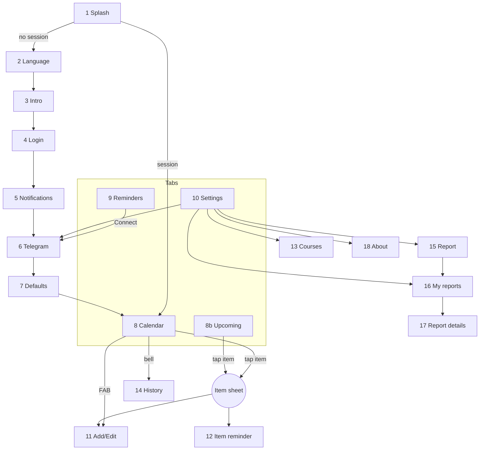

# 06 — Screens and User Flows

18 screens + 1 bottom sheet. No emoji in any copy; every visual cue is an icon from `lucide-react-native`.

## 1. Screen inventory

### A. Launch and onboarding (7)

| # | Screen | Route | Content | Notes |
|---|---|---|---|---|
| 1 | Splash | `/splash` | Animated logo (see `07-design-system.md`) | Hands back to the guard in `app/index.tsx`: session -> the first unfinished post-login step (5, 6, 7) or Calendar; no session -> the first unfinished step (Language, Intro) or Login |
| 2 | Language | `/(onboarding)/language` | Two large cards: العربية / English | Applies RTL and reloads if needed |
| 3 | Intro | `/(onboarding)/intro` | 3 swipeable slides, dots, Skip, Next / Get started | Shown once |
| 4 | Sign in / Create account | `/(onboarding)/login` | Student number, app password (show/hide), Sign in, Create account (password rules shown inline), privacy note | Errors inline: wrong credentials, number already registered, weak password, too many attempts. No university login here |
| 5 | Notification permission | `/(onboarding)/allow-notifications` | Illustration, why we need it, Allow / Not now | System prompt only after Allow. Not `/notifications`: that URL is the history (screen 14) |
| 6 | Telegram | `/(onboarding)/connect-telegram` and `/telegram` | Benefits, Connect Telegram, Skip; linked state with username and Unlink | Same screen reused from Settings (Unlink only there; onboarding shows Continue) |
| 7 | Default reminders | `/(onboarding)/defaults` | The 4 rule cards pre-filled, Continue | Reuses `RuleCard` from screen 9 |

### B. Tabs (4)

| # | Screen | Route | Content |
|---|---|---|---|
| 8 | Calendar (home) | `/(tabs)/calendar` | Header: month title, Today button, bell with unread badge. Month grid with coloured dots per type. Day list below (sorted by time). FAB "+" |
| 8b | Upcoming (AR: المواعيد) | `/(tabs)/upcoming` | Second tab. The next 7 calendar days: from the start of today to the end of today + 6 days in the user's timezone; the header shows the range. Top tabs All / Quiz / TMA / Exam / Lecture (All first; the type tabs come from `itemTypeMeta`). `GET /items?from=&to=` (plus `type=` on a type tab), sorted by time, grouped by day; items already past earlier today stay listed, dimmed and marked "Done". Rows show time, title, course and "Opens ..." when a quiz is not open yet. Pull to refresh runs the on-device LMS sync (Moodle fetch, then `POST /me/lms/ingest`). Tap opens the item sheet |
| 9 | Reminders | `/(tabs)/reminders` | 4 `RuleCard`s: type icon + name, offset chips (remove with x, add with +: preset times or "Custom" with days / hours / minutes fields, 5 minutes to 14 days, max 5, no duplicates; arbitrary offsets read as e.g. "1 day 2 h 30 min before"), channel toggles Push / Telegram (Telegram disabled with "Connect" link if not linked) |
| 10 | Settings | `/(tabs)/settings` | Account (name, student number, LMS status, sync now), University account (Moodle) row, Change app password, Language, Theme (System / Light / Dark), Telegram, Courses, Report a problem, My reports, About & privacy, Log out, Delete account |

All tab screens share the hero header + floating card layout from docs/07 section 5a. Home (`/(tabs)/home`): large hero with date, time-of-day greeting with the first name, "You have N items today" and the bell; a floating stat card (one tile per item type, next 7 days); then Next up, Today's lectures, a "Latest news" floating card (the 3 newest course announcements; hidden until the university is connected and there is news; a row opens that course's news) and LMS sync. Calendar: month grid in a floating card over the hero, sync banners below it. Upcoming: week range and the type filter pills on the hero. Settings: profile card floating over the hero.

### C. Bottom sheet

| Sheet | Opened from | Content |
|---|---|---|
| Item details | Tap on item in Calendar or Upcoming, or notification tap | Type badge, title, course, date/time (+ "opens at" for quizzes), location, next reminder, actions: Join on Teams (when `url` is a `teams.microsoft.com` / `teams.live.com` link, e.g. Moodle calendar lectures; replaces Open in LMS), Open in LMS (other Moodle items), Customize reminder, Mute item, Edit / Delete (manual items) |

### D. Secondary screens (9)

| # | Screen | Route | Content |
|---|---|---|---|
| 11 | Add / edit item | `/item/new`, `/item/[id]/edit` | Segmented control Exam / Quiz / Lecture (from `itemTypeMeta`). Exam: course, title, date, time, duration, location. Quiz: course, title, close date and time (`scheduled_at`), optional opens-at date and time (`available_from`), location. Lecture: course, title, weekdays chips, time, duration, from, until, location. Duration is typed in hours (decimals, 0.25 steps, 0.25..10; Arabic-Indic digits and the Arabic decimal separator accepted) and sent as minutes (lecture `duration_minutes`, exam `ends_at`); editing shows stored minutes as hours |
| 12 | Item reminder | `/item/[id]/reminders` | Toggle "Use custom times", offset chips (same + sheet with presets and Custom as screen 9), Reset to default |
| 13 | Courses | `/courses` | List of courses (code, name, upcoming count), mute switch per course. Tap a course to open its detail |
| 13a | Course detail | `/course/[id]` | `GET /courses/{id}`. Header: code, name. Tutor card (tutor name or "not known yet", group) with the course mute switch. Next 30 days, one section per item type that has items (Quizzes, TMAs, Exams, Lectures, via `itemTypeMeta`); tap opens the item sheet. "Lecture times": the user's weekly schedules (weekday names and time in the app language, duration in hours e.g. "1.5 h", location, date range). Loading / empty / error / offline via `DataState`. "Course news" section: the 5 newest announcements of the course (`GET /announcements?course=`), "See all" opens `/course-news/[id]` (infinite scroll). Announcement card: pinned marker, subject, relative and absolute date, author, body (3 lines, tap to expand), "Join on Teams" when the post has a Teams link |
| 14 | Notification history | `/notifications` | Grouped by day, unread highlighted, tap opens target, Mark all read |
| 14b | University account | `/connect-lms` | Explanation, privacy note, Moodle username (prefilled from the student number), Moodle password (show/hide), Connect / Reconnect; when connected: status, last sync, Disconnect (confirmation). Reached from Settings -> Connections -> University account (Moodle), the Home call to action and the Calendar "Reconnect" banner | The Moodle password is used once on the phone; the token stays in secure storage. Success: back with a message after the first sync. Errors: wrong Moodle credentials, university unavailable, backend |
| 14c | Change app password | `/change-password` | Current, new and confirm password; server messages shown under the matching field | Settings -> Account. Stores the fresh token pair the backend returns |
| 14a | My log | `/history` | `GET /items/history`. Items the student marked with a status (lectures and any other type), newest first, grouped by month. Hero filter pills: All marked, then each visible status from `itemStatusMeta`. Floating card per item: type tile, title, course, date, status pill, note (3 lines, tap the note to expand). Tap the card opens `/item/[id]/status` to change status and note; the list updates after saving. Infinite scroll (cursor). Empty state explains how to mark items. Entry points: Settings (Connections section) and a card under the Home stats |
| 15 | Report a problem | `/reports/new` | Category picker, description, up to 3 screenshots, auto device info notice, Send |
| 16 | My reports | `/reports` | List with status pill (New / In progress / Resolved / Closed) |
| 17 | Report details | `/reports/[id]` | Original report, conversation with admin replies, reply box. Live: a WebSocket (`/ws/v1/reports/<id>/`) is open while the screen is shown, so new replies appear instantly and messages are sent over it; when it is not connected, sending falls back to `POST /reports/{id}/replies` |
| 18 | About & privacy | `/about` | Hero with the logo mark, app name, version and tagline; floating sections: What Zakerni does (description + feature rows), Unofficial app notice (student initiative, not affiliated with the Arab Open University), Your data and privacy (the university password never leaves the phone; what the server stores; nothing sold or shared; disconnect or delete in Settings), Developer and contact (developer name from `GET /meta/app` `developer_name`, hidden when empty; Telegram support, hidden when empty; Report a problem opens `/reports/new`; privacy policy, disabled when the link is missing) |

Secondary screens use a compact `HeroHeader` with a back button (and their actions, e.g. Mark all read, New report) instead of the plain header.

### E. System states (every data screen)

Loading skeleton, empty state (icon + message + action), error state with Retry, offline banner, LMS token expired banner ("Sign in again to keep reminders working").

## 2. Navigation map

## 3. User flows

### Flow 1 — First launch

1. Splash animation (about 1.6 s).
2. Choose language. If Arabic, RTL is applied (reload happens here, before any real content).
3. Intro slides (skippable).
4. Create an app account (student number + app password) or sign in. The backend creates the account and the default reminder rules; the university is not involved yet. Optional later: Settings -> Connect university (Moodle username and password typed on the phone, the phone gets a Moodle token itself and calls `POST /me/lms/connect`, then runs the first sync: fetch from Moodle, push to the backend). Settings -> Disconnect university removes the Moodle items and the link but keeps manual items, lectures and SIS data.
5. Explain notifications -> system permission prompt -> register FCM token.
6. Optional Telegram linking (opens Telegram, returns, screen shows "Connected as @user").
7. Review default reminder times -> Continue.
8. Land on Calendar. While the first sync runs, a small "Syncing your courses" banner is shown; items appear when done.

### Flow 2 — Daily reminder (core)

1. Moodle sync finds a new quiz -> reminders scheduled from the user's rules.
2. At `send_at`: push + Telegram message in the user's language.
3. User taps the push -> app opens Calendar on the item's day with the item sheet open.
4. "Open in LMS" -> Moodle quiz page in the browser.

Quizzes published outside Moodle: Calendar -> "+" -> Quiz -> course, title, close date and time, optional opens-at, location -> Save -> the quiz rule reminders are scheduled.

### Flow 3 — Add a weekly lecture

Calendar -> "+" -> Lecture -> course, weekdays, time, duration, until -> Save -> occurrences appear every week; each gets the lecture rule reminders.

### Flow 4 — Customize reminders

- **By type:** Reminders tab -> Quiz card -> add "1 hour before", disable Telegram -> saved instantly (optimistic update, all future quiz reminders rescheduled on the server).
- **One item:** item sheet -> Customize reminder -> custom offsets or Mute.
- **One course:** Settings -> Courses -> mute course.

### Flow 5 — Report a problem

Settings -> Report a problem -> category, description, screenshots -> Send -> confirmation. Admin replies in the dashboard -> user gets push "New reply on your report" -> Report details.

### Flow 6 — LMS token expired

The phone's Moodle fetch gets `invalidtoken` (or the stored token is missing) -> the app sends `lms_status: "expired"` to the backend -> account marked expired -> one push + Telegram message "Sign in again to keep your reminders working" -> banner on Calendar ("Reconnect") -> connect screen (Moodle password only, username prefilled) -> sync resumes. "Sync now" on an account that is not connected opens the same screen; auto sync and pull to refresh do nothing in that state.

### Flow 7 — Change language

Settings -> Language -> confirm dialog ("The app will restart") -> `PATCH /me {language}` -> reload. Future notifications arrive in the new language.

## 4. Admin (Django Admin + Unfold)

| Page | Content |
|---|---|
| Dashboard | KPI cards: users, active devices, Telegram-linked users, reminders sent / failed (24 h), open reports. Chart: reminders sent per day (14 days). Table: last 10 failed syncs |
| Users | Search by username/name, LMS status, devices, Telegram status. No token visible |
| Reports | Filter by status/category, detail with attachments and device info, reply inline (reply triggers push), change status |
| Broadcasts | Create (AR + EN title/body, channels), preview recipients count, action "Send now"; list shows the recipient ("Everyone" or the user) with an audience filter, so direct messages are visible as history |
| User: Send notification | Detail button and list action (exactly one selected user). Form: title and message in AR and EN (at least one language; one language is used for both), Push and Telegram checkboxes, recipient name, language, active devices and Telegram link status. Success message says which channels will carry it, or that the user has no device or Telegram link (history only) |
| Logs | Sync logs, scheduled reminders (filter by status/channel) — read-only |
