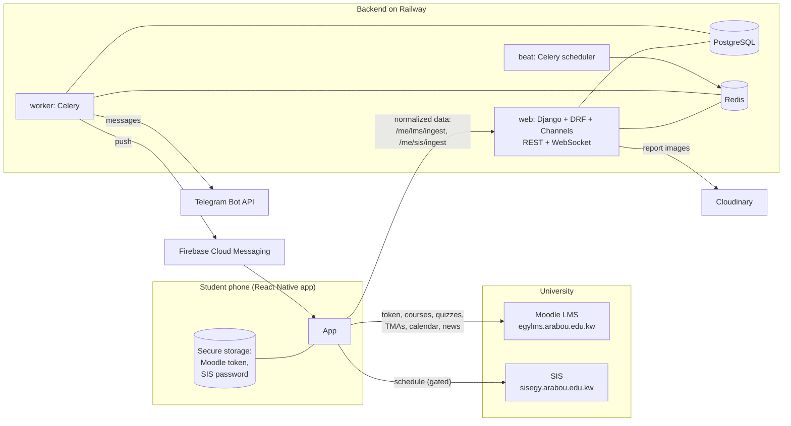
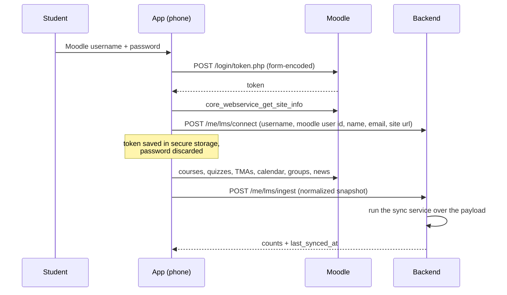
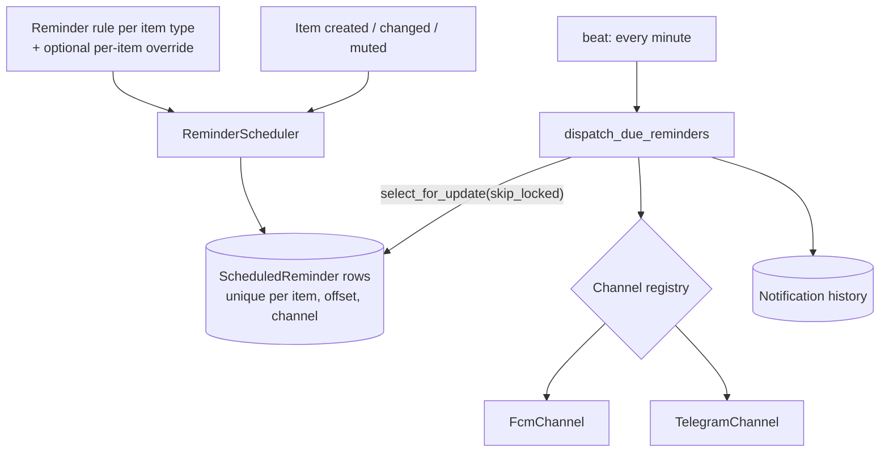

# 10 - Features and Integrations

This document explains what Zakerni does, how each feature works end to end, and how the backend integrates with the university systems and third-party services. For exact request/response shapes see `05-api-spec.md`; for data tables see `04-erd.md`.

Zakerni is a student initiative that reminds Arab Open University (AOU, Egypt) students of quizzes, TMAs, exams and lectures. It is **not** an official university application.

---

## 1. System at a glance

**Key design decision: the phone talks to the university, the server does not.** Moodle (and the SIS) reject requests from cloud data-center addresses, and the student's credentials are safest on the student's own device. So the app signs in to Moodle itself, reads the data, and posts only the resulting data to the backend. The backend never calls Moodle or the SIS in this mode and never receives the Moodle token or the SIS password.

---

## 2. Accounts and authentication

| Feature | Detail |
|---|---|
| Account | The student creates an **app account** with their student number and an app password (min 8 characters, Django password validators). Only a salted hash of the password is stored. |
| Sign in | `POST /auth/signin`. Wrong credentials, unknown user and unusable password return the same `401 invalid_credentials` (no user enumeration). 10 failures per username in 15 minutes lock the account for a while (`429 too_many_attempts`). |
| Tokens | JWT access + refresh (simplejwt); refresh tokens are blacklisted on logout and on password change. `POST /auth/change-password` returns a fresh token pair and blacklists the old refresh tokens. |
| Throttling | Login, register and change-password share a 5/min throttle. |
| Recovery | There is no email flow yet. A staff member sets a temporary password from the admin ("Set a temporary password" action, shown once). |
| Delete account | `DELETE /me` removes the student's data; support reports are anonymised instead of deleted. |

The university password is **never** part of the app account. Connecting the university is a separate, optional step (section 3).

---

## 3. Connecting the university (Moodle LMS)

**Moodle web-service functions used by the phone** (mobile web service `moodle_mobile_app`):

| Purpose | Moodle function |
|---|---|
| Token | `/login/token.php` |
| Site info / user id | `core_webservice_get_site_info` |
| Current-term courses | `core_course_get_enrolled_courses_by_timeline_classification` (`inprogress`), fallback `core_enrol_get_users_courses` filtered by dates |
| Quizzes | `mod_quiz_get_quizzes_by_courses` |
| TMAs / assignments | `mod_assign_get_assignments` |
| Online lectures (Teams) | `core_calendar_get_calendar_events` |
| Student's group | `core_group_get_course_user_groups` |
| Group tutor | `core_enrol_get_enrolled_users` (members of the group, non-student roles) |
| Course news | `mod_forum_get_forums_by_courses` + `mod_forum_get_forum_discussions` (fallback `..._paginated`) |

**What the backend does with the payload** (`SyncMoodleAccount`, unchanged whether data came from a server fetch or a phone ingest):

- Upserts `Course`, `Enrollment` and `Item` rows (quiz, TMA, calendar lecture) idempotently using the Moodle instance id.
- **Skips activities dated before the course start date.** AOU reuses course shells every term, so a current course can still contain quizzes from 2024; those are ignored and soft-deleted.
- Marks enrollments that are no longer in progress as inactive and soft-deletes their items, cancelling their pending reminders.
- Stores the student's group name and tutor name on the enrollment.
- Writes a `SyncLog` row for the admin.

**When sync runs:** on app open and foreground (at most once per 10 minutes), on pull to refresh and on "Sync now". Ingest is throttled (1/min, 200/day per user). A rejected Moodle token sends `lms_status: "expired"` so the backend marks the connection expired and notifies the student once.

**Disconnect:** `DELETE /me/lms` removes the connection and the Moodle-sourced items; manual items, lectures and SIS data are kept.

---

## 4. Items: quizzes, TMAs, exams, lectures

| Type | Source | Reminder anchor (`scheduled_at`) |
|---|---|---|
| Quiz | Moodle, or entered manually | closing time |
| TMA | Moodle | due date |
| Exam | Manual, or SIS | exam start |
| Lecture | Manual weekly schedule, Moodle calendar event, or SIS timetable | lecture start |

- **Weekly lecture schedules**: the student defines weekdays, start time, duration and the date range once. The backend generates every occurrence up to the end date (capped at one year); a daily job fills gaps.
- Moodle and SIS items are read-only; the student can still mute them and customise their reminders.
- **Per-item status and note** (all types, including Moodle items): `attended`, `postponed`, `cancelled`, `done` plus a free-text note (`PATCH /items/{id}/status`). Status and note never change reminders. The log of marked items is `GET /items/history` (filters, cursor pagination), shown in the app as "My log".
- **Upcoming**, calendar and Home read `GET /items` with a date range and filters (`type`, `from`, `to`, `course`).

---

## 5. Reminders and notifications

- **Defaults** (created at sign-up): quiz 24 h and 3 h before; TMA and exam 3 days and 1 day before; lecture 30 minutes before. Rules are per item type, with up to 5 offsets between 5 minutes and 14 days; each channel can be switched on or off. Per-item overrides and per-course mute are supported; the app offers a custom "days / hours / minutes" input.
- **A reminder is never sent twice**: a unique constraint on `(item, offset, channel)` plus `select_for_update(skip_locked=True)` in the dispatcher. Late reminders (more than 30 minutes late) are skipped; failures retry up to 3 times.
- **Message content** is rendered in the student's language and timezone (default `Africa/Cairo`): title, time, location (or "Online (Teams)" with the join link on Telegram) and the group tutor's name.
- **Channels** implement one `NotificationChannel` protocol (`send(user, message) -> DeliveryResult`) and never raise for expected failures (invalid token, blocked bot). Adding a channel does not change the dispatcher.
- **Notification history** is stored per user (`GET /notifications`, unread count, mark as read). Kinds: reminder, broadcast, report reply, announcement, system.

### Course announcements
The phone reads the news forum of each course (e.g. "lecture cancelled / moved") and includes it in the ingest. The backend stores announcements **per user** (group-specific posts must not leak between students), converts HTML to plain text, extracts Teams links, and serves `GET /announcements`. A push and Telegram notification is created for **new** announcements modified within the last 3 days (old posts stay silent; at most 5 notifications per ingest, the rest summarised). Retention is 180 days.

---

## 6. Integrations

### 6.1 Moodle LMS
Described in section 3. All calls go through the `MoodleDataClient` protocol; tests use a fake client, and the same sync service also runs over a `PayloadMoodleClient` built from the phone's ingest payload.

### 6.2 University SIS (Student Information System)
Provides the official exam timetable and class timetable. **Status: plumbing ready, switched off.**

- The backend has `POST /me/sis/ingest` (gated by `SIS_INGEST_ENABLED`, default off) that runs the existing `SyncSisAccount` over normalized schedule entries: exams become exam items, timetable rows become weekly lecture schedules linked to courses by course code (a group suffix such as `EL112 (28)` is ignored when matching).
- The app has a phone-side SIS client behind the `EXPO_PUBLIC_SIS_ENABLED` flag. The SIS password stays on the phone.
- The SIS protects its API against access from outside its own web client. Reliable use needs **official access from the university** (API key or allow-listing). No attempt is made to bypass that protection.

### 6.3 Firebase Cloud Messaging (push)
`FcmChannel` uses `firebase-admin` with a service account provided as `FIREBASE_CREDENTIALS_JSON` (or a file path). Devices register `POST /devices` with an FCM token; an invalid token deactivates the device. Push needs a development/production build of the app (not Expo Go).

### 6.4 Telegram
- **Linking:** the app asks `POST /telegram/link` for a one-time deep link (10-minute, single-use token). Pressing Start in the bot calls our webhook with `/start <token>`, which links the chat to the account.
- **Webhook:** `POST /telegram/webhook`, protected by the `X-Telegram-Bot-Api-Secret-Token` header (constant-time compare). Register it once with `python manage.py telegram_set_webhook --url https://<domain>`. A `403 Forbidden` from Telegram (the student blocked the bot) auto-unlinks the chat.
- **Local development:** `python manage.py telegram_poll` uses `getUpdates` instead of the webhook (never run it against the production bot, it deletes the webhook).

### 6.5 Cloudinary
Report attachment images (max 3 per report, 5 MB each, JPEG/PNG/WebP, validated with Pillow) are stored on Cloudinary when `CLOUDINARY_URL` is set, because Railway's disk is not persistent. Without it, local storage is used.

### 6.6 Support and admin
- **Reports:** students create reports with a category, description, screenshots and automatic device info (`/reports`); staff reply from the admin.
- **Real-time chat:** a WebSocket at `/ws/v1/reports/<id>/?token=<JWT>` (Django Channels over Redis) delivers new replies instantly to the student and to the admin page. Replies sent over REST or from the admin are broadcast on the same channel.
- **Admin panel (Unfold)** at `/admin/`: dashboard KPIs and a reminders chart, users (with a "Send notification" button for a single user and a temporary-password action), devices, courses, items, reminders, reports, sync logs, Moodle and SIS accounts. It is themed to match the app, in Arabic (RTL) and English.
- **Broadcasts:** staff send a message to all students or to one student in each student's language, via push and/or Telegram.

---

## 7. Background jobs (Celery beat)

| Task | Schedule | Purpose |
|---|---|---|
| `reminders.dispatch_due_reminders` | every minute | Send due reminders |
| `schedule.expand_lecture_schedules` | daily 00:10 (Cairo) | Fill missing lecture occurrences |
| `moodle.enqueue_moodle_syncs` | every 30 min | Server-side sync for accounts that have a token (skips phone-synced accounts) |
| `sis.enqueue_sis_syncs` | every 6 h | Server-side SIS sync for password-based accounts (skips phone-synced ones) |
| `reminders.cleanup` | daily 03:00 | Remove old finished reminders |
| `notifications.cleanup_link_tokens` | daily 03:05 | Remove expired Telegram link tokens |

---

## 8. Security and privacy summary

- The Moodle token and the SIS password stay on the phone (secure storage). The app account password is stored only as a Django hash.
- No secrets in code or git: everything comes from environment variables.
- All datetimes are stored in UTC and converted at the edges.
- Every user-facing string is translatable (Arabic and English); layouts are RTL-safe.
- Ingest endpoints validate sizes, string lengths and timestamp ranges, and only ever write to the authenticated user's own data. Existing shared course names are never overwritten by a student's payload.
- Errors use one envelope: `{"error": {"code", "message", "details"}}`.
- The OpenAPI schema is served at `/api/schema/`, Swagger UI at `/api/docs/` and Redoc at `/api/redoc/`.

---

## 9. Deployment

One Docker image runs three Railway services: `web` (migrations then Daphne, HTTP + WebSocket), `worker` (Celery) and `beat` (Celery scheduler, exactly one instance), plus the Railway PostgreSQL and Redis plugins. `start.sh` picks the role from the service name. See `backend/README.md` for the environment variables and the first-deploy steps.
